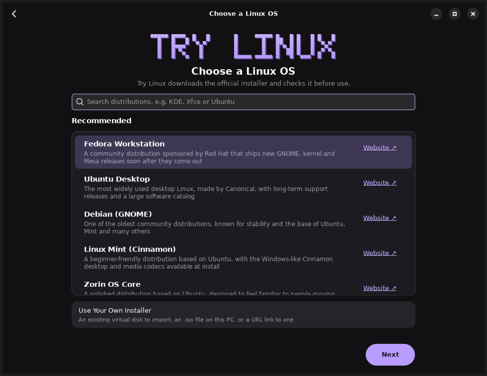
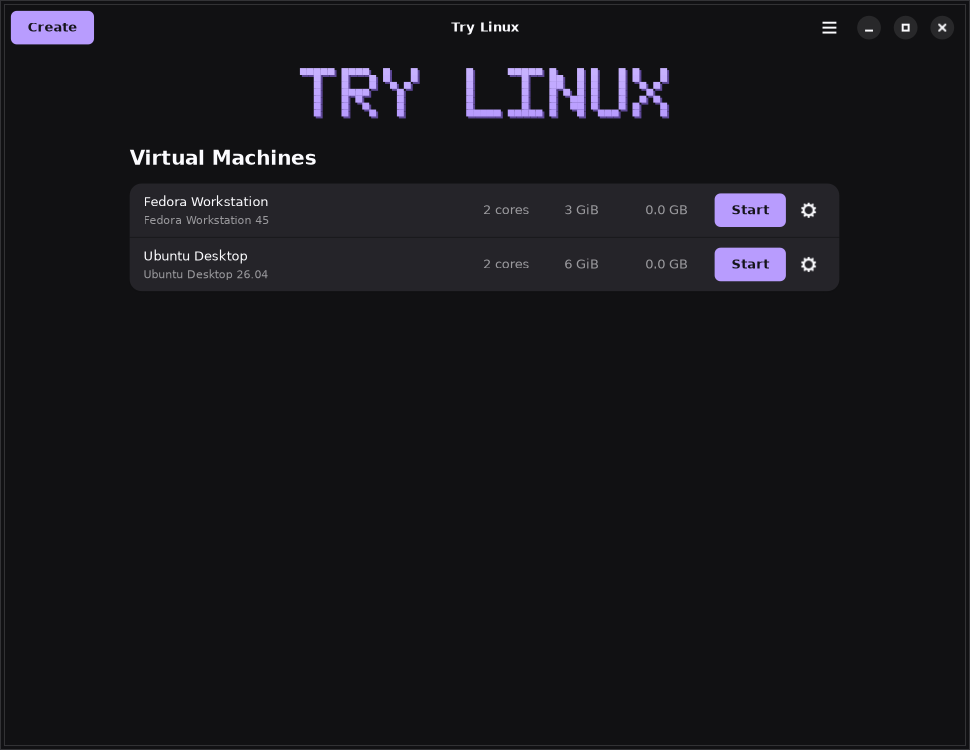
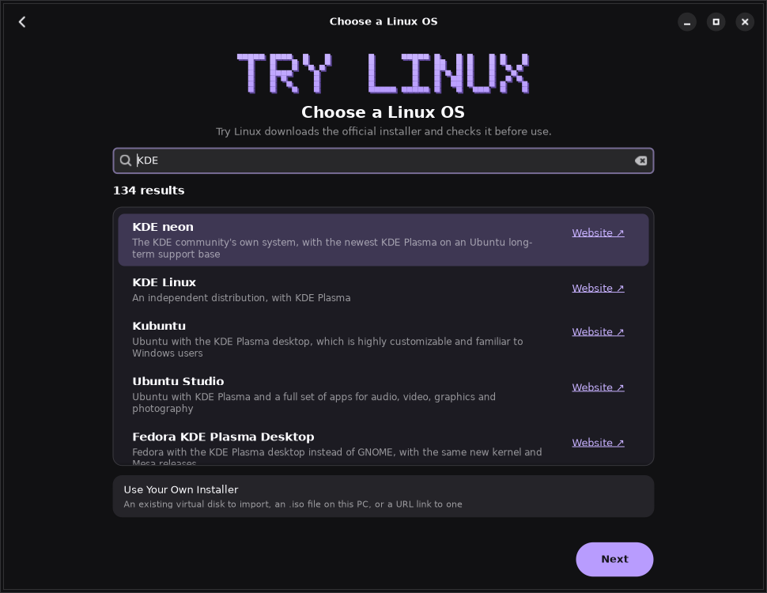
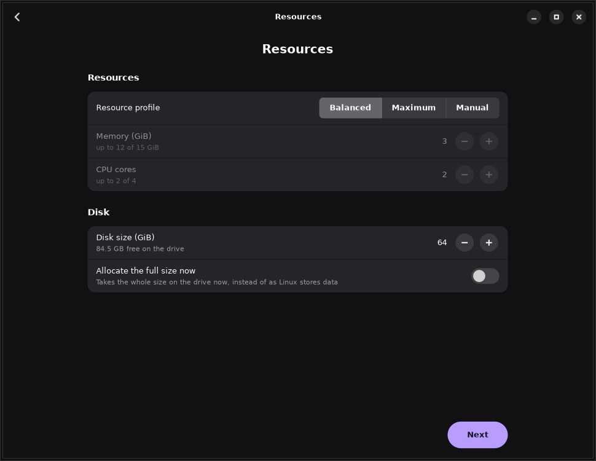
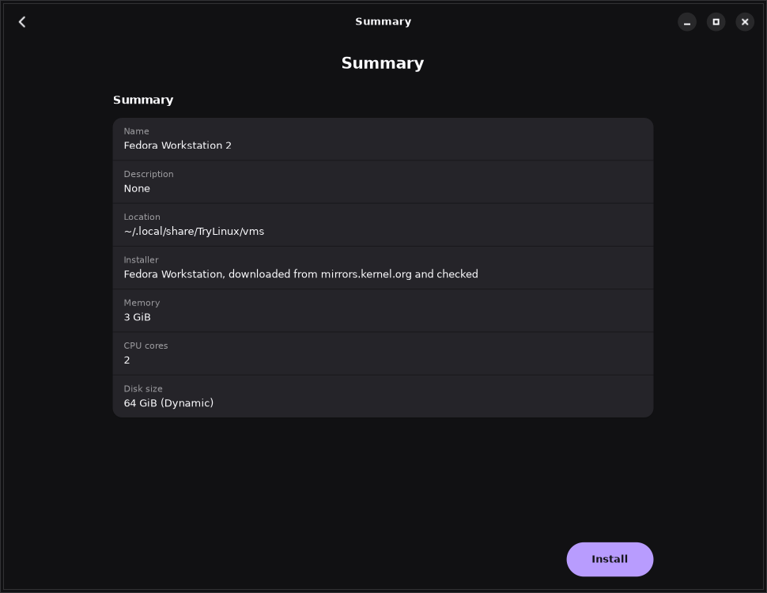
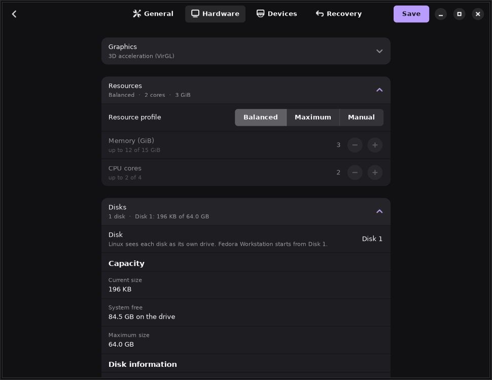
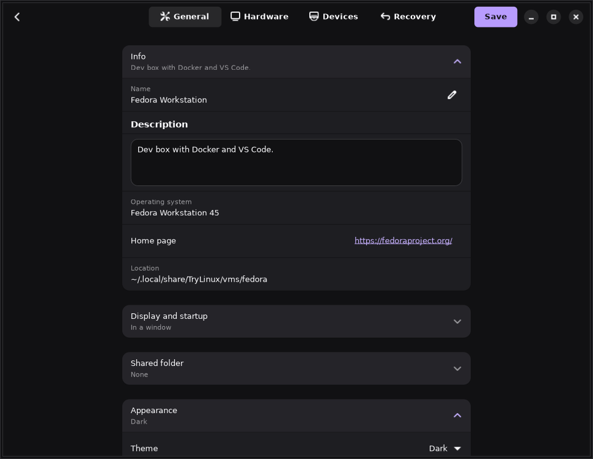
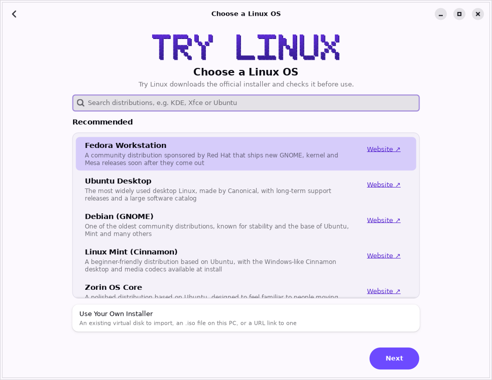
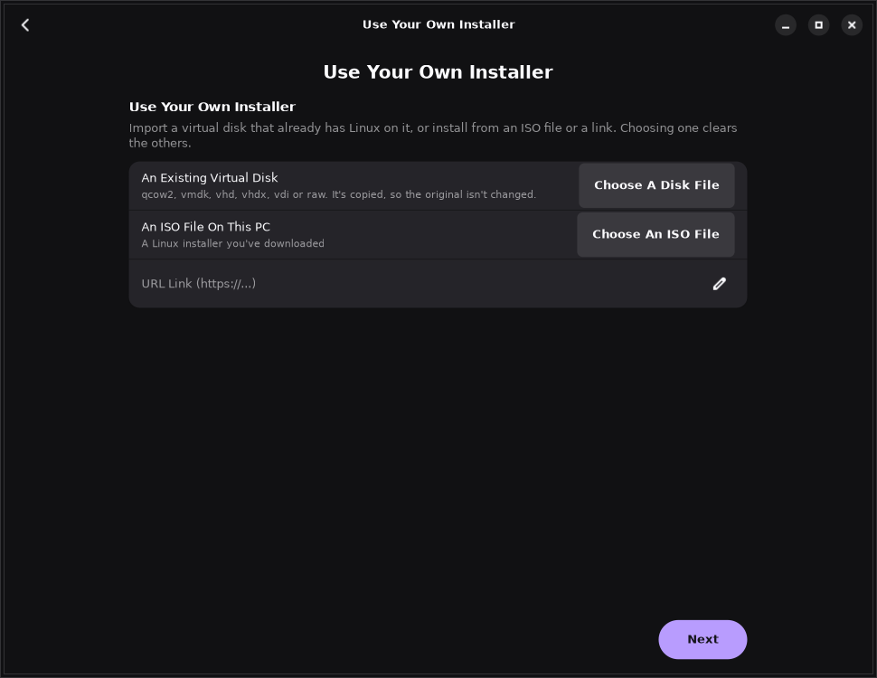
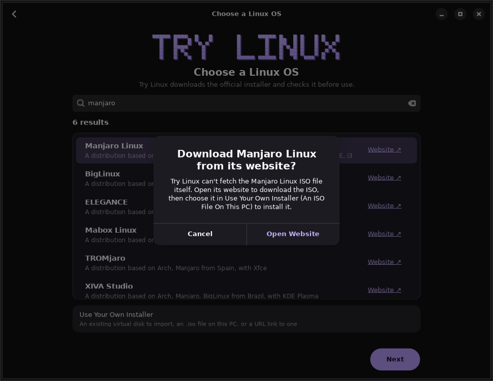

# Try Linux for Linux

> **Try Linux for Linux has moved** to [donnysaengkio/try-linux](https://github.com/donnysaengkio/try-linux/tree/main/linux), with the Windows and Mac editions and its full history. This repository is archived; new releases and issues are there.

Try another Linux distribution on your Linux PC without repartitioning your drive. Pick a
distribution, and Try Linux downloads the official installer, checks it against the
distribution's published SHA-256 or SHA-512 checksum, creates a virtual disk and boots it in
a window. It uses QEMU with KVM, so systems run at close to native speed, with 3D
acceleration (VirGL) where your QEMU supports it.

It runs on **x86_64** and **ARM64** (aarch64) PCs. This is the Linux edition of
[Try Linux for Windows](https://github.com/donnysaengkio/try-linux) and
[Try Linux for Mac](https://github.com/donnysaengkio/try-linux-macos), built with GTK 4 and
libadwaita.

> **Preview:** this first version is being tested. It builds and passes its self-test on
> GitHub's x86_64 and ARM64 Linux runners: finding and checking each distribution's
> installer, the disk tools, every screen in both themes, and booting Alpine Linux to a
> login prompt with Try Linux's own QEMU settings (in 4 seconds with KVM on x86_64). It
> hasn't been clicked through on a real desktop yet. Please report problems in
> [Issues](../../issues).

## Screenshots



| | |
|---|---|
|  |  |
| **Virtual Machines:** status, CPU, memory and disk, Start or Power, Settings | **Search:** over 500 distributions, each with a **Website ↗** link |
|  |  |
| **Create:** name, description and location, then resources and disk size, then a summary | **Summary**, before Install |
|  |  |
| **Settings > Hardware:** graphics, resources, and Disks with Disk Utilities | **Settings > General:** info, display and startup, shared folder, appearance |
|  |  |
| **Light theme** | **Use Your Own Installer:** an existing virtual disk, an ISO file or a link |

## Distributions

On **x86_64** PCs, the recommended list is Fedora Workstation, Ubuntu Desktop, Debian
(GNOME), Linux Mint (Cinnamon) and Zorin OS Core. **Search** finds over 90 more that Try
Linux downloads and checks the same way (Kubuntu, Fedora KDE, openSUSE, Arch, NixOS...),
plus over 400 more from DistroWatch that you download from their website.

On **ARM64** PCs, the recommended list is Fedora Workstation, Ubuntu Desktop, Debian and
openSUSE Tumbleweed (the ARM64 installers). Search also lists the distributions you
download from their website; pick their ARM64 (aarch64) ISO.

The list comes from [the Windows edition's catalog](https://github.com/donnysaengkio/try-linux/blob/main/catalog/distros.json)
and is checked each time you open Choose a Linux OS (downloaded again only when it has
changed), so new entries appear without a new release. Every result has a **Website ↗**
link to the distribution's home page. For a distribution Try Linux can't download itself,
**Next** offers to open its website; download the ISO there, then pick it in **Use Your Own
Installer > An ISO File On This PC**.



**Use Your Own Installer** installs from an `.iso` file or a download link, or imports an
existing virtual disk (qcow2, vmdk, vhd, vhdx, vdi or raw) that already has Linux on it. An
imported disk is copied, so the original isn't changed; a VMware disk brings its name,
description, memory and cores from the `.vmx` file beside it.

## Requirements

- **libadwaita 1.5 or later and GTK 4**, with Python 3 (PyGObject): Ubuntu 24.04, Debian 13,
  Fedora 40, openSUSE Tumbleweed, Arch or newer.
- **QEMU** with KVM. Your user needs access to `/dev/kvm` (on most distributions, be in the
  `kvm` group). On ARM64, QEMU's UEFI firmware too.

Ubuntu / Debian:

```bash
sudo apt install python3-gi gir1.2-gtk-4.0 gir1.2-adw-1 qemu-utils qemu-system-gui qemu-system-x86
```

On ARM64, use `qemu-system-arm qemu-efi-aarch64` in place of `qemu-system-x86`.

Fedora:

```bash
sudo dnf install python3-gobject gtk4 libadwaita qemu-kvm qemu-img qemu-ui-gtk qemu-ui-opengl qemu-audio-pipewire qemu-device-display-virtio-vga-gl
```

On ARM64, use `qemu-device-display-virtio-gpu-gl edk2-aarch64` in place of `qemu-device-display-virtio-vga-gl`.

Arch:

```bash
sudo pacman -S python-gobject gtk4 libadwaita qemu-desktop
```

On ARM64, add `edk2-aarch64`.

If you aren't in the `kvm` group yet:

```bash
sudo usermod -aG kvm $USER
```

Then sign out and back in. Try Linux shows what's missing on its home screen, with the
command for your distribution.

## Install

1. Download `TryLinux-<version>-preview-linux.tar.gz` from
   [Releases](../../releases) (one download for x86_64 and ARM64) and extract it.
2. Run `./install.sh` in the extracted folder. It installs Try Linux for you, without sudo:
   the app in `~/.local/share/try-linux`, the `try-linux` command in `~/.local/bin`, and
   **Try Linux** in your apps menu.

You can also run `./try-linux` from the extracted folder without installing.

**Updates:** when a new version is out, the home screen shows **Update**. Try Linux downloads
it, checks it against its published checksum and puts it in place. To uninstall, run
`./install.sh --uninstall` (your systems are kept in `~/.local/share/TryLinux`).

## Using it

1. **Create** (or the first screen, when you have no systems yet): choose a distribution,
   then name it, set its resources (Balanced, Maximum, or Manual memory and CPU cores) and
   disk size (dynamic, or **Allocate the full size now**), check the summary and **Install**.
2. Try Linux downloads and checks the installer, makes the disk and starts the installer in
   a QEMU window. When Linux restarts after installing, Try Linux starts it again from its
   disk.
3. **Virtual Machines** lists your systems: **Start**, or **Power** (Shut Down, Restart,
   Pause, Force Stop) while one runs, and the gear for **Settings**.

Closing a system's window doesn't turn it off; use **Power > Shut Down**.

## Settings

- **General:** **Info** (name, description, the OS, its home page and where it's kept),
  **Display and startup** (fullscreen, a desktop shortcut, start when you sign in),
  **Shared folder** (in Linux: `sudo mount -t 9p -o trans=virtio host /mnt`),
  **Appearance** (Dark or Light, or follow the system) and **About** (versions, updates).
- **Hardware:** **Graphics** (3D acceleration with VirGL), **Resources**, and **Disks**:
  each disk's size, free space and location, then **Disk Utilities**: reclaim free space
  when Linux deletes files (TRIM), **Resize**, **Compact**, **Add Disk** and **Remove**.
- **Devices:** sound and microphone, a **CD/DVD drive** for ISOs such as drivers or rescue
  disks (changed at once while the system runs), and **network** (shared with this PC, port
  forwards only, or none) with port forwards such as `tcp:2222:22`.
- **Recovery:** snapshots, back up and restore as a copy, clean up downloaded installers,
  start from an ISO once to repair Linux, and delete.

## Where things are kept

- Systems: `~/.local/share/TryLinux/vms/<name>/` (`vm.json`, `disk.qcow2`, and `qemu.log`
  from the last start), or the folder you chose in Create.
- Downloaded installers: `~/.local/share/TryLinux/isos/`.
- Try Linux's own settings: `~/.config/TryLinux/settings.json`.

## Troubleshooting

- **A system runs very slowly:** KVM isn't in use. Check that virtualization (Intel VT-x /
  AMD-V) is on in your PC's firmware settings and that you're in the `kvm` group.
- **The 3D graphics don't start:** turn off **3D acceleration** in **Settings > Hardware >
  Graphics**. VirGL needs QEMU's GL display (`qemu-system-gui` / `qemu-ui-opengl`) and
  working OpenGL drivers.
- **A system stops straight away:** its window shows why, and `qemu.log` in its folder has
  QEMU's full output.

## License

MIT. See [LICENSE](LICENSE).
